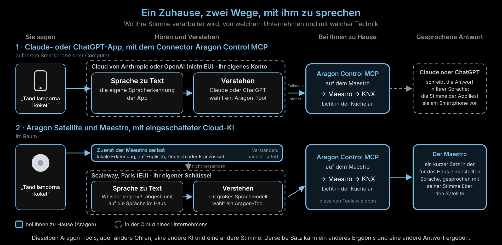

# Gleicher Satz, andere Antwort: Claude oder ChatGPT im Vergleich zum Aragon Satellite

Sie sagen *„Tänd lamporna i köket“* zu ChatGPT oder Claude und danach zum
Aragon Satellite in der Küche. Das Licht reagiert vielleicht nicht gleich,
und die Antwort, die Sie hören, ist eine andere. Warum?

Beide Wege enden am selben Ort: bei den Tools von Aragon Control MCP auf
Ihrem Maestro, die das Licht über KNX schalten. Aber vorher hört jeder Weg
Sie mit einer anderen Spracherkennung und versteht Sie mit einer anderen KI,
betrieben von verschiedenen Unternehmen. Und die Antwort wird von
verschiedenen Systemen geschrieben und gesprochen, oft in einer anderen
Sprache.

Durchgezogene Kästen laufen bei Ihnen zu Hause, auf dem Maestro.
Gestrichelte Kästen laufen in der Cloud eines Unternehmens.

## Schritt für Schritt

| Schritt | Claude- oder ChatGPT-App + Aragon Control MCP | Aragon Satellite + Maestro, Cloud-KI an |
|----|---------|---------|
| Mikrofon | Ihr Smartphone oder Computer | Der Satellite im Raum |
| Erster Versuch | Keiner: alles geht in die Cloud der App | Der Maestro selbst, offline, in seiner eigenen Sprache (Englisch, Deutsch oder Französisch). Versteht er den Befehl, handelt er sofort. |
| Sprache zu Text | Die eigene Spracherkennung der App, bei Anthropic oder OpenAI (außerhalb der EU), mit Ihrem eigenen Konto | Whisper large-v3 bei Scaleway in Paris (EU), mit Ihrem eigenen Schlüssel, abgestimmt auf die zu Hause gesprochene Sprache |
| Verstehen | Claude (Anthropic) oder GPT (OpenAI), mit den Anweisungen dieses Unternehmens | Ein großes Sprachmodell bei Scaleway, mit den Anweisungen von Aragon |
| Weg ins Haus | Tailscale Funnel, verschlüsselt, Anmeldung mit dem Eigentümer-Passwort des Maestro | Der Maestro fragt Scaleway und führt die Antwort selbst aus |
| Aktion | Aragon Control MCP → Maestro → KNX | Aragon Control MCP → Maestro → KNX (dieselben Tools) |
| Gesprochene Antwort | Frei von Claude oder ChatGPT geschrieben, meist in der Sprache, die Sie gesprochen haben, und von der Stimme der App auf Ihrem Smartphone vorgelesen | Ein kurzer Satz in der zu Hause gesprochenen Sprache, gesprochen mit der Stimme des Maestro über den Satellite (oder mit einer Online-Stimme aus der EU, falls eingeschaltet) |

## Warum das Ergebnis abweichen kann

- **Andere Ohren.** Jede Spracherkennung kann ein Wort anders hören. In
  Aragons eigenen Tests wurde ein schwedisches „bordslampan“ einmal als
  anderes Wort verstanden, und die falsche Lampe wurde geschaltet. Die
  Spracherkennung der App hört denselben Satz vielleicht anders, besser oder
  schlechter.
- **Der Maestro versucht es zuerst.** Beim Satellite hat die
  Offline-Erkennung des Maestro die erste Chance, in seiner eigenen Sprache.
  Nur was er nicht versteht, geht an den Cloud-KI-Server. Die App macht
  diesen Schritt nie.
- **Eine andere KI entscheidet.** Claude oder ChatGPT und das Modell bei
  Scaleway sind verschiedene Modelle mit verschiedenen Anweisungen. Bei „das
  Licht in der Küche“ schaltet das eine vielleicht jedes Licht in der Küche,
  das andere nur eines, oder es fragt nach.
- **Andere Gespräche.** In der App erinnert sich der Assistent an den Chat
  und kann nachfragen oder mehrere Tools nacheinander aufrufen. Über den
  Satellite steht jeder Befehl für sich.

## Warum die Antwort anders klingt

- **Wer sie schreibt.** Claude oder ChatGPT schreibt einen eigenen Satz, so
  lang er will. Der Maestro sagt absichtlich nur einen kurzen Satz, damit es
  im Raum ruhig bleibt.
- **Welche Sprache.** Die App antwortet meist in der Sprache, die Sie
  gesprochen haben. Der Maestro antwortet in der zu Hause gesprochenen
  Sprache, eingestellt im Abschnitt **Cloud-KI-Server** der Maestro-Seite.
  Das kann eine andere Sprache sein als die eines Gastes.
- **Welche Stimme.** Die App verwendet die Stimme ihres Unternehmens auf
  Ihrem Smartphone. Der Maestro spricht mit seiner eigenen installierten
  Stimme oder mit einer Online-Stimme aus der EU, wenn Sie diese
  eingeschaltet haben.

## So kommen Sie mit dem Satellite zu ähnlicheren Ergebnissen

- Stellen Sie im Abschnitt **Cloud-KI-Server** der Maestro-Seite die
  **Zu Hause gesprochene Sprache** auf die Sprache ein, die wirklich
  gesprochen wird.
- Werden zu Hause mehrere Sprachen gesprochen, schalten Sie die Option für
  weitere Sprachen ein. Befehle in einer anderen Sprache werden dann zweimal
  transkribiert: Die Antwort kommt etwas später und kostet etwas mehr.
- Schalten Sie die Online-Stimme ein, wenn Sie eine natürlichere Stimme für
  die Antworten möchten.

---

Stand: Aragon v2.0.0 (November 2026). Ohne Cloud-KI bleibt der Weg über den
Satellite vollständig bei Ihnen zu Hause, auf Englisch, Deutsch oder
Französisch. Was die Apps von Claude und ChatGPT mit der Sprache tun,
entscheiden diese Unternehmen; siehe deren eigene Datenschutzbestimmungen.
