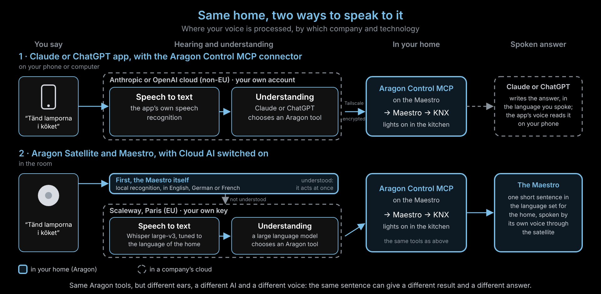

# Same Sentence, Different Answer: Claude or ChatGPT vs. the Aragon Satellite

You say *"Tänd lamporna i köket"* to ChatGPT or Claude, and then to the
Aragon satellite in the kitchen. The lights may not react the same way, and
the answer you hear is different. Why?

Both end in the same place: the Aragon Control MCP tools on your Maestro,
which switch the lights through KNX. But before that, each path hears you
with different speech recognition and understands you with a different AI,
run by different companies. And the answer is written and spoken by
different systems, often in a different language.

Solid boxes run in your home, on the Maestro. Dashed boxes run in a
company's cloud.

## Step by step

| Step | Claude or ChatGPT app + Aragon Control MCP | Aragon Satellite + Maestro, Cloud AI on |
|----|---------|---------|
| Microphone | Your phone or computer | The satellite in the room |
| First try | None: everything goes to the app's cloud | The Maestro itself, offline, in its own language (English, German or French). If it understands, it acts at once. |
| Speech to text | The app's own speech recognition, at Anthropic or OpenAI (outside the EU), with your own account | Whisper large-v3 at Scaleway in Paris (EU), with your own key, tuned to the language spoken at home |
| Understanding | Claude (Anthropic) or GPT (OpenAI), with that company's instructions | A large language model at Scaleway, with Aragon's instructions |
| Way into the home | Tailscale Funnel, encrypted, signed in with the Maestro owner password | The Maestro asks Scaleway and carries out the answer itself |
| Action | Aragon Control MCP → Maestro → KNX | Aragon Control MCP → Maestro → KNX (the same tools) |
| Spoken answer | Written freely by Claude or ChatGPT, usually in the language you spoke, read by the app's voice on your phone | One short sentence in the language spoken at home, spoken by the Maestro's voice through the satellite (or by an online EU voice, if switched on) |

## Why the result can differ

- **Different ears.** Each speech recognizer can hear a word differently.
  In Aragon's own tests a Swedish "bordslampan" was once heard as another
  word and the wrong lamp switched. The app's recognizer may hear the same
  sentence differently, better or worse.
- **The Maestro tries first.** With the satellite, the Maestro's offline
  recognition gets the first chance, in its own language. Only what it
  doesn't understand goes to the Cloud AI server. The app never takes that
  step.
- **A different AI decides.** Claude or ChatGPT and the model at Scaleway
  are different models with different instructions. Faced with "the lights
  in the kitchen", one may switch every kitchen light and the other only
  one, or ask back.
- **Different conversations.** In the app, the assistant remembers the chat
  and can ask a follow-up or call several tools in a row. Through the
  satellite, each command stands on its own.

## Why the answer sounds different

- **Who writes it.** Claude or ChatGPT writes its own sentence, as long as
  it likes. The Maestro says one short sentence on purpose, so the room
  stays quiet.
- **Which language.** The app usually answers in the language you spoke.
  The Maestro answers in the language spoken at home, set in the
  **Cloud AI Server** section of the Maestro page. That can be another
  language than the one a guest used.
- **Which voice.** The app uses its company's voice on your phone. The
  Maestro speaks with its own installed voice, or an online EU voice if you
  switched that on.

## Getting closer results with the satellite

- In the **Cloud AI Server** section of the Maestro page, set
  **Language spoken at home** to the language people really use.
- If several languages are spoken at home, turn on the option for other
  languages. Commands in another language are then transcribed twice: the
  answer comes a little later and costs a little more.
- Switch on the online voice if you want a more natural voice for the
  answers.

---

Based on Aragon v2.0.0 (November 2026). Without Cloud AI the satellite path
stays entirely in the home, in English, German or French. What the Claude
and ChatGPT apps do with speech is decided by those companies; see their own
privacy terms.
