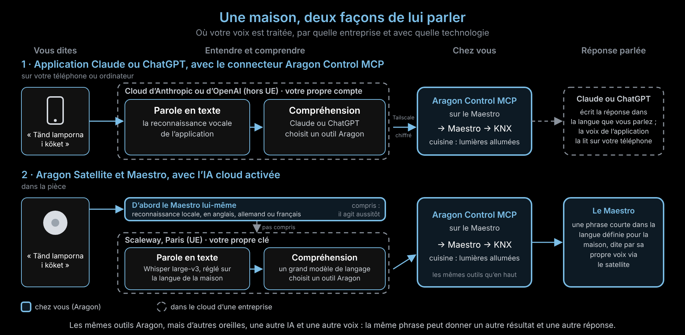

# Même phrase, autre réponse : Claude ou ChatGPT face au satellite Aragon

Vous dites *« Tänd lamporna i köket »* à ChatGPT ou à Claude, puis au
satellite Aragon de la cuisine. Les lumières ne réagissent peut-être pas de
la même façon, et la réponse que vous entendez est différente. Pourquoi ?

Les deux chemins aboutissent au même endroit : les outils d'Aragon Control
MCP sur votre Maestro, qui allument les lumières via KNX. Mais avant cela,
chaque chemin vous entend avec une autre reconnaissance vocale et vous
comprend avec une autre IA, gérées par des entreprises différentes. Et la
réponse est écrite et dite par des systèmes différents, souvent dans une
autre langue.

Les cadres pleins fonctionnent chez vous, sur le Maestro. Les cadres en
pointillés fonctionnent dans le cloud d'une entreprise.

## Étape par étape

| Étape | Application Claude ou ChatGPT + Aragon Control MCP | Satellite Aragon + Maestro, IA cloud activée |
|----|---------|---------|
| Microphone | Votre téléphone ou ordinateur | Le satellite dans la pièce |
| Premier essai | Aucun : tout part dans le cloud de l'application | Le Maestro lui-même, hors ligne, dans sa propre langue (anglais, allemand ou français). S'il comprend, il agit aussitôt. |
| Parole en texte | La reconnaissance vocale de l'application, chez Anthropic ou OpenAI (hors UE), avec votre propre compte | Whisper large-v3 chez Scaleway à Paris (UE), avec votre propre clé, réglé sur la langue parlée à la maison |
| Compréhension | Claude (Anthropic) ou GPT (OpenAI), avec les instructions de cette entreprise | Un grand modèle de langage chez Scaleway, avec les instructions d'Aragon |
| Chemin vers la maison | Tailscale Funnel, chiffré, connexion avec le mot de passe propriétaire du Maestro | Le Maestro interroge Scaleway et exécute lui-même la réponse |
| Action | Aragon Control MCP → Maestro → KNX | Aragon Control MCP → Maestro → KNX (les mêmes outils) |
| Réponse parlée | Écrite librement par Claude ou ChatGPT, en général dans la langue que vous avez parlée, et lue par la voix de l'application sur votre téléphone | Une phrase courte dans la langue parlée à la maison, dite par la voix du Maestro via le satellite (ou par une voix en ligne de l'UE, si elle est activée) |

## Pourquoi le résultat peut être différent

- **D'autres oreilles.** Chaque reconnaissance vocale peut entendre un mot
  différemment. Lors des tests d'Aragon, un « bordslampan » suédois a été
  compris une fois comme un autre mot, et la mauvaise lampe s'est allumée.
  La reconnaissance de l'application peut entendre la même phrase
  autrement, mieux ou moins bien.
- **Le Maestro essaie d'abord.** Avec le satellite, la reconnaissance hors
  ligne du Maestro a la première chance, dans sa propre langue. Seul ce
  qu'il ne comprend pas est envoyé au serveur IA cloud. L'application ne
  fait jamais cette étape.
- **Une autre IA décide.** Claude ou ChatGPT et le modèle chez Scaleway sont
  des modèles différents avec des instructions différentes. Face à « les
  lumières de la cuisine », l'un allumera peut-être toutes les lumières de
  la cuisine et l'autre une seule, ou posera une question.
- **D'autres conversations.** Dans l'application, l'assistant se souvient de
  la conversation et peut poser une question ou appeler plusieurs outils à
  la suite. Via le satellite, chaque commande est traitée seule.

## Pourquoi la réponse sonne différemment

- **Qui l'écrit.** Claude ou ChatGPT écrit sa propre phrase, aussi longue
  qu'il le souhaite. Le Maestro dit volontairement une seule phrase courte,
  pour que la pièce reste calme.
- **Quelle langue.** L'application répond en général dans la langue que
  vous avez parlée. Le Maestro répond dans la langue parlée à la maison,
  réglée dans la section **Serveur IA cloud** de la page du Maestro. Ce peut
  être une autre langue que celle d'un invité.
- **Quelle voix.** L'application utilise la voix de son entreprise sur votre
  téléphone. Le Maestro parle avec sa propre voix installée, ou avec une
  voix en ligne de l'UE si vous l'avez activée.

## Obtenir des résultats plus proches avec le satellite

- Dans la section **Serveur IA cloud** de la page du Maestro, réglez la
  **Langue parlée à la maison** sur la langue vraiment utilisée.
- Si plusieurs langues sont parlées à la maison, activez l'option pour les
  autres langues. Les commandes dans une autre langue sont alors transcrites
  deux fois : la réponse arrive un peu plus tard et coûte un peu plus cher.
- Activez la voix en ligne si vous voulez une voix plus naturelle pour les
  réponses.

---

Version : Aragon v2.0.0 (novembre 2026). Sans l'IA cloud, le chemin via le
satellite reste entièrement chez vous, en anglais, allemand ou français. Ce
que les applications Claude et ChatGPT font de la voix est décidé par ces
entreprises ; consultez leurs propres règles de confidentialité.
